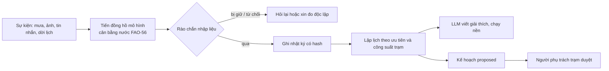

# Kiến trúc RiceBridge Ops

Tài liệu này mô tả cách demo được thiết kế sau khi tái cấu trúc thành package `ricebridge` (`src/ricebridge`). Nội dung nghiệp vụ nằm ở [nghiên cứu](../research/README.md), cách chạy ở [hướng dẫn](../manual/demo-guide.md).

## 1. Nguyên tắc thiết kế

1. **LLM hiểu ngôn ngữ, công cụ tất định quyết định.** LLM chỉ làm ba việc: đọc tin nhắn tiếng Việt thành số đo, chọn người đo lại độc lập, và viết lời giải thích cùng tin nhắn cho nông dân. Cân bằng nước, an toàn theo giai đoạn lúa, xếp lịch theo công suất trạm và cổng duyệt đều là mã tất định.
2. **LLM không có công cụ hành động.** Claude CLI chạy với `--tools ""`. Không có đường nào để LLM duyệt lịch, sửa số đo hay điều khiển bơm.
3. **Con người duyệt mọi lịch bơm.** Kế hoạch ở trạng thái `proposed` cho đến khi người phụ trách trạm duyệt.
4. **Mọi quyết định để lại bằng chứng.** Nhật ký chỉ ghi thêm, có chuỗi hash. Số đo bị loại vẫn được giữ lại kèm lý do.
5. **Chạy offline được.** Câu trả lời LLM, bản dịch, kết quả đọc ảnh và thời tiết đều được cache và commit. Không có LLM thì bộ quy tắc thay thế.

## 2. Bố cục mã nguồn

```text
src/ricebridge/
  paths.py            Mọi đường dẫn file (nguồn duy nhất)
  cli.py, __main__.py Kiểm tra điều kiện chạy rồi khởi động server (python -m ricebridge)
  engine.py           Lõi: trạng thái cụm, sự kiện, rào chắn nhập liệu, lập lịch, what-if, nhật ký
  i18n.py             Mẫu câu EN/JA/VI cho phần do mã sinh ra
  weather_source.py   Thời tiết Open-Meteo (có cache)
  llm/
    client.py         Gọi Claude CLI: cache theo hash prompt, validate schema, thử lại, hủy
    interpreter.py    Bộ phân tích bằng quy tắc, chặn chỉ dẫn, prompt và schema của LLM
    translate.py      Dịch lời LLM sang JA/VI/EN và lưu cache
  vision/
    hook.py           Cầu nối đọc ảnh và kiểm tra nhất quán
    gauge_reader.py   Đọc mực nước từ ảnh bằng Claude vision
    consistency.py    Cờ STALE_PHOTO, PHOTO_SUSPECT, SOURCES_DISAGREE...
  server/app.py       HTTP API và phục vụ web/
  sim/                Mô hình cân bằng nước và các chính sách (dùng chung với mô phỏng)
  web/                Giao diện tĩnh (HTML/JS/CSS)
data/                 Dữ liệu cố định: fixtures, llm_cache, i18n, vision
outputs/              Kết quả sinh ra: sim, vision
tests/                unit/ (pytest) và e2e/ (Playwright)
scripts/              Công cụ phụ: capture, đánh giá và tạo ảnh thử
```

Phụ thuộc đi một chiều: `server → engine → (llm, vision, sim, weather_source, i18n)`. Ngoại lệ có chủ đích: `llm/translate.py` nạp `engine` muộn (lazy) để quét các câu LLM cần dịch.

## 3. Luồng xử lý một sự kiện



`Demo.handle()` ([engine.py](../../src/ricebridge/engine.py)) chạy `advance_to()` (tiến ngày bằng mưa thật, hệ số cây trồng Kc, thấm và rò theo từng thửa), gọi hàm `on_<sự kiện>()`, rồi `finish()` lập kế hoạch. Phần LLM viết lời giải thích chạy nền để kế hoạch hiện ra ngay và có thể duyệt trong lúc LLM còn đang viết.

### Lập lịch

`assess()` chiếu mực nước từng thửa tới lượt bơm kế tiếp. Ưu tiên 0 là trổ bông, 1 là bón thúc và giai đoạn mạ, 2 là thửa gần ngưỡng −15 cm. `make_plan()` xếp theo (ngày vi phạm, ưu tiên, mực nước thấp nhất). Trạm bơm được 4 thửa mỗi lượt; phần còn lại bị dời sang lượt sau. Thửa có số đo cũ hơn 2 ngày được đánh dấu "đo trước khi mở cống". Các hằng số `AWD_MARGIN_CM`, `WET_MARGIN_CM` và ngưỡng xung đột 5 cm lấy từ `sim/policies.py`, nên demo và mô phỏng dùng chung một nguồn.

## 4. Rào chắn nhập liệu

Một số đo từ tin nhắn chỉ được ghi khi qua lần lượt các kiểm tra trong `Demo.intake()`:

| # | Kiểm tra | Nếu không qua |
| --- | --- | --- |
| 1 | Không chứa chỉ dẫn cho agent (bộ chặn từ khóa, chạy cả khi LLM sập) | Từ chối, không ghi |
| 2 | Là báo cáo mực nước và có đủ thửa, giá trị | Không ghi, hỏi lại |
| 3 | Trong khoảng −40 đến +15 cm (chiều cao bờ) | Không ghi, hỏi lại |
| 4 | LLM và bộ quy tắc không lệch quá 0,5 cm | Hỏi lại |
| 5 | Độ tin cậy từ 0,75 trở lên | Xin số trên ống đo |
| 6 | Lệch cân bằng nước không quá 5 cm | Giữ lại là `suspicious`, xin đo độc lập |

Ngoài ra:

- `guard_numbers` bắt LLM nếu lời viết chứa con số không có trong dữ liệu đầu vào.
- Validator từ chối nếu LLM chọn người đo lại không độc lập (ví dụ chụp lại cùng ống).
- Ảnh đi qua `consistency.py`: ảnh chụp trước trận mưa gần nhất là `STALE_PHOTO`, ảnh lệch cả cảm biến lẫn cân bằng nước (khi hai nguồn này khớp nhau) là `PHOTO_SUSPECT`.

## 5. Nhật ký bằng chứng

`Demo.append()` băm SHA-256 mỗi bản ghi cùng hash của bản ghi trước (`prev_hash`). `verify_chain()` tính lại toàn chuỗi; chế độ tamper sửa một bản sao để chỉ ra chỗ chuỗi vỡ. `completeness()` chấm mỗi thửa trên 5 tiêu chí (số đo trong 3 ngày, có người đọc ống, không còn xung đột, đã duyệt, đủ nguồn-giờ-GPS-người ghi), từ đó ra "x/6 thửa đủ bằng chứng".

## 6. LLM và cache

`llm/client.py` gọi `claude -p` qua CLI, ép JSON theo schema, kiểm bằng validator, thử lại một lần. Khóa cache là sha256 của (model, prompt, dữ liệu, schema). Chế độ chạy: `auto` (cache trước, CLI khi lỡ), `replay` (chỉ cache, offline), `live` (luôn gọi), `rules` (không LLM).

| Việc | Model | Ghi chú |
| --- | --- | --- |
| `parse_message` | Haiku 4.5 | Hiểu tiếng miền Tây, ví dụ "nước ba phân" là +3 cm |
| `choose_remeasurer` | Haiku 4.5 | Chọn người đo lại độc lập và viết lời nhờ |
| `plan_brief` | Sonnet 5.5 | Giải thích kế hoạch và viết tin nhắn cho từng thửa |
| `read_gauge_photo` | Sonnet 5.5 | Đọc mực nước từ ảnh (xem ghi chú bảo mật ở mục 9) |

## 7. Máy chủ và đồng thời

`server/app.py` là `ThreadingHTTPServer` thuần thư viện chuẩn, chỉ nghe `127.0.0.1`.

- Sau mỗi thay đổi, `Runtime.publish()` xuất một snapshot JSON. `GET /api/state` chỉ đọc snapshot đó nên không bao giờ chờ LLM.
- Chỉ một job thay đổi trạng thái chạy cùng lúc (`start_job`). Bận thì trả 409 kèm tiến độ; giao diện xếp hàng tin nhắn.
- Việc chậm (viết giải thích, dịch) chạy ở "side job" và cập nhật snapshot khi xong.
- `epoch` tăng mỗi lần reset; các job cũ bị bỏ. Yêu cầu duyệt phải khớp `plan_id` và `epoch`.
- What-if lưu trạng thái, áp tình huống giả định, lập kế hoạch rồi khôi phục. Nó không ghi nhật ký và không thể duyệt.

## 8. Dữ liệu và đường dẫn

Toàn bộ đường dẫn nằm trong [paths.py](../../src/ricebridge/paths.py). Thư mục gốc suy ra từ vị trí package, nên cần cài bản chỉnh sửa được (`pip install -e .`).

| Loại | Vị trí | Ghi vào git |
| --- | --- | --- |
| Dữ liệu cố định (thời tiết, cache LLM, bản dịch, ảnh thử) | `data/` | Có, cố ý |
| Kết quả mô phỏng và đánh giá | `outputs/` | Có (giữ lại để đối chiếu), trừ `shots/` và `video/` |
| File sinh khi chạy (dự báo mới, ảnh tải lên, log) | `.cache/` | Không |

## 9. Giới hạn đã biết

- Bộ phân tích quy tắc dùng khi không có LLM còn lỗi nhận nhầm: chữ "bón phân" bị đọc thành +4 cm vì "bón" và "bốn" trùng nhau sau khi bỏ dấu, và từ phủ định ("không cạn") chưa được xử lý. LLM và kiểm tra 5 cm giảm rủi ro này ở chế độ bình thường.
- Bộ chặn chỉ dẫn dựa trên danh sách từ khóa: có thể chặn nhầm ("duyệt") và bỏ sót cách nói khác. Lớp bảo vệ thật là LLM không có công cụ hành động và kiểm tra lệch 5 cm.
- `run_pump_if_due` tự duyệt kế hoạch còn ở trạng thái `proposed` khi đến ngày bơm ("theo kịch bản demo"). Chỉ xảy ra khi người trình bày bỏ qua bước duyệt.
- Đọc ảnh dùng `claude -p --allowedTools Read`. Ảnh người dùng tải lên là dữ liệu không tin cậy; khi triển khai thật cần gửi ảnh trực tiếp thay vì cấp quyền đọc file.
- Nhật ký chỉ ghi thêm theo quy ước, hash dài 16 ký tự hex, nằm trong bộ nhớ. Phát hiện sửa một phần, không chống được việc tính lại toàn chuỗi. Dùng làm bằng chứng thật cần chữ ký hoặc neo hash ra ngoài.
- Cảm biến, người, ruộng và tin nhắn là kịch bản của nhóm; ảnh thước đo là ảnh tổng hợp.
