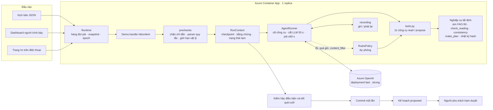
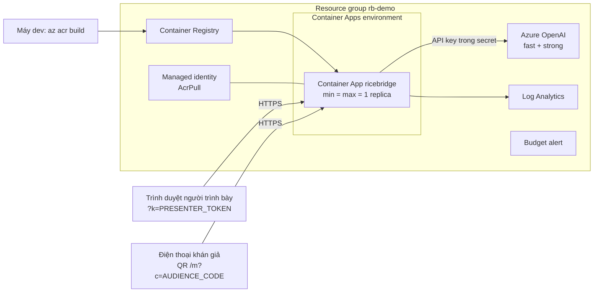
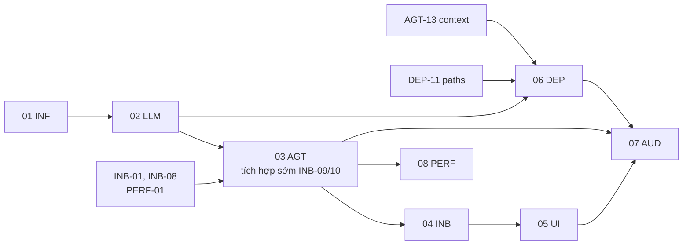

# Kế hoạch làm lại RiceBridge Ops: agent thật trên Azure

Bộ tài liệu này mô tả hệ thống mới và chia việc thành các task cụ thể. Mỗi task có mã (ví dụ `AGT-03`), file chính, điều kiện xong và ước lượng giờ để đưa thẳng vào backlog.

Thiết kế mục tiêu (chi tiết ở [ADR 0004](../adr/0004-agent-loop-on-azure-openai.md) và [ADR 0005](../adr/0005-hosting-on-azure-container-apps.md); các ADR vẫn là đề xuất, code hiện tại chưa triển khai redesign):

- LLM: **Azure OpenAI**, gọi bằng function calling ngay trong tiến trình Python. **Gỡ hẳn Claude CLI.**
- Xác thực: **API key**. Ở máy dev để trong `.env`; trên cloud là secret của Container App, Bicep lấy trực tiếp bằng `listKeys()` nên không ai phải chép key bằng tay.
- Chạy: **Azure Container Apps**, 1 replica, HTTPS công khai. Vẫn chạy local được để phát triển.
- Hạ tầng tạo mới bằng **Bicep**.

## 0. Phạm vi và cách kết luận đã đáp ứng

Đích là **agent điều phối có giới hạn cho demo hackathon**: model chọn công cụ, đọc kết quả và điều tra tiếp; mã nghiệp vụ kiểm bằng chứng, tính nước/lịch; con người duyệt. Không cần nhiều agent hay bộ nhớ vector để đạt mục tiêu này. Replay và RulesPolicy phải được ghi nhãn rõ, không trình bày như model đang điều tra live.

Text, ảnh và transcript HTX được xử lý chung. Chưa bao gồm nhận file âm thanh/STT, kết nối Zalo/cảm biến thật, điều khiển bơm thật, xác thực nông dân thực địa hay chứng nhận tín chỉ carbon. Trạng thái trong RAM và log hash của demo chưa đáp ứng lưu bằng chứng bền vững/chống tính lại toàn chuỗi.

[09 · Hợp đồng và nghiệm thu](09-acceptance.md) ánh xạ yêu cầu trong repo tới task/test. Chỉ kết luận M0–M3 đạt khi có bằng chứng ở các gate tương ứng; nếu muốn xác nhận toàn bộ tiêu chí cuộc thi phải đối chiếu thêm Idea Proposal và rubric chính thức. Sửa lỗi parser/tự duyệt/completeness là thay đổi có chủ đích, không buộc giữ lỗi để khớp baseline.

## 1. Vấn đề của luồng hiện tại

| # | Vấn đề | Chỗ trong code |
| --- | --- | --- |
| 1 | Mỗi sự kiện có một hàm `on_<id>` riêng, gọi công cụ theo thứ tự cố định và tự viết kết luận | `engine.py`: `EVENTS`, `on_start` … `on_pump_change` |
| 2 | Kết luận viết sẵn cả trong giao diện | `web/app.js`, các ô "focal" khoảng dòng 755–800 |
| 3 | Phụ đề `sub` của sự kiện nói trước kết quả | `engine.py`: `EVENTS[*].sub` |
| 4 | LLM chỉ làm 3 việc nhỏ; ở `--stage` cả 3 lấy từ cache | `llm/interpreter.py` |
| 5 | Danh sách người đo lại chỉ có cho F2 | `engine.py`: `REMEASURE_OPTIONS` |
| 6 | Ảnh, giọng nói, đo lại và tin nhắn trực tiếp đi theo các đường khác nhau | `on_photo`, `on_voice`, `on_remeasure`, `post_message` |
| 7 | Mỗi lần gọi Claude CLI mất 10–50 giây, cộng thêm một lượt dịch riêng; đọc ảnh phải cấp quyền `Read` file | ADR 0001, `llm/translate.py`, `vision/gauge_reader.py` |

## 2. Hình hài hệ thống mới

### Thành phần

### Luồng một đầu vào

1. Server validate đầu vào, gán nguồn/danh tính/giờ nhận/evidence_id và receipt. Input live đi vào queue server có giới hạn; thao tác gửi lại cùng khóa không tạo job thứ hai.
2. Prechecks read-only chạy trước runner, publish progress ngay. Input bị từ chối không tiến đồng hồ hay đổi bằng chứng/kế hoạch.
3. Tạo RunContext từ trạng thái trước đầu vào, giữ epoch/state_version. Trên bản sao, advance_to bằng FAO-56 rồi áp sensor/weather/thông báo trạm đã xác nhận nguồn.
4. AgentRunner tự chọn công cụ, dùng kết quả để điều tra tiếp. Công cụ propose chỉ sửa bản sao; progress có nhãn provisional. Bằng chứng và rào chắn được kiểm ngay trong công cụ, không phụ thuộc model gọi đủ các bước gợi ý.
5. draft_plan tạo kế hoạch cho phiên bản dữ liệu cuối. Model viết summary/findings/needs_human/messages/gloss theo schema đủ vi/en/ja; validator kiểm refs, thửa, đơn vị, ngày và hành động khớp bằng chứng/kế hoạch. Thiếu kế hoạch khi dữ liệu đổi thì không commit.
6. finish commit chính kế hoạch đã kiểm một lần, trạng thái proposed; không tính lại kế hoạch sau khi model đã giải thích. Người trình bày duyệt với plan_id/epoch/state_version đầy đủ. Đến giờ bơm mà chưa duyệt thì bỏ lượt và cảnh báo, không tự duyệt.
7. Lỗi/Skip/output filter/replay drift bỏ bản sao chạy dở rồi RulesPolicy xử lý từ cùng checkpoint offline. Input filter thì từ chối; reset hủy run cũ. Ngân sách gồm vision, retry, final, validation/commit; response muộn không ghi được.

### Bộ công cụ của agent

| Công cụ | Loại | Bọc hàm hiện có |
| --- | --- | --- |
| `get_cluster_overview` | read | `snapshot()` rút gọn |
| `get_field_state` | read | `levels`, `last_reading`, `stage`, `FieldSpec.note` |
| `get_recent_weather` | read | `weather`, `latest_rain()` |
| `project_water_balance` | read | `project()` |
| `read_gauge_photo` | read | Vision adapter trên evidence_id/hash ảnh; live gửi ảnh đã bỏ GPS, replay dùng output đã ghi |
| `compare_sources` | read | phần so sánh trong `intake()` / `on_photo()` |
| `find_independent_measurers` | read | `candidates_for()` |
| `submit_reading` | propose | check_reading + bằng chứng/nguồn/thời điểm/cờ ảnh; chỉ tạo hiệu ứng trên bản sao |
| `request_remeasure` | propose | Người/ống đo độc lập từ registry server, gắn request_id với xung đột |
| `draft_plan` | propose | make_plan trên draft version hiện tại; duy nhất kế hoạch cuối được commit proposed |
| `reply_to_sender` | propose | Nháp tin trên dashboard; validator số/thửa/giờ/hành động và refs |

Không có công cụ duyệt lịch, bật bơm, sửa số đo hay xóa nhật ký.

Propose vẫn là thao tác có hiệu ứng: phải có giao dịch/chống ghi trùng, không chỉ đặt tên công cụ là read/propose. Tin nhắn là bản nháp; không có tích hợp gửi ra tài khoản Zalo. Xác nhận thông báo trạm là bước nhập dữ liệu tất định, không mở quyền đổi lịch trực tiếp cho model.

### Triển khai

- Trạng thái trong bộ nhớ: 1 replica, single revision, không traffic split/scale về 0. Các cấu hình này không ngăn restart; DEP-12 diễn tập khôi phục phiên bằng recording, không khôi phục approval ngầm.
- Cookie presenter bảo vệ state/media/evidence và mọi API điều khiển. Phiên audience chỉ cho POST message/photo và GET status của item thuộc chính thiết bị; không đọc snapshot chung.
- Image cài package thường với data cố định chỉ đọc và runtime writable cấu hình riêng. Recording/cache/upload mới ghi runtime; mất khi restart, không tự đưa dữ liệu khán giả vào git.
- Chạy local (`python -m ricebridge`) vẫn như cũ: chỉ nghe `127.0.0.1`, không cần token.

### Chế độ chạy

| Cờ | Hành vi |
| --- | --- |
| `--stage` / `--mode replay` | Offline mọi adapter; bản ghi có thì replay, miss/drift thì quy tắc, ảnh thiếu kết quả thì hỏi lại |
| `--mode auto` | Bản ghi hợp lệ thì replay; miss gọi Azure nếu có cấu hình/ngân sách; thiếu cấu hình/lỗi thì cảnh báo và offline rules |
| `--mode live` | Luôn gọi Azure trong ngân sách; thiếu cấu hình thì fail startup; lỗi run dùng quy tắc an toàn |
| `--mode rules` | Không dùng LLM hay mạng; RulesPolicy và bằng chứng có sẵn |

Pre-flight/forecast/vision/translation đều tuân mode. Stage có thể nhận câu/ảnh mới nhưng không hứa đọc ảnh chưa ghi bằng model. Giới hạn mặc định cắt lời gọi LLM ở 50 giây, hoàn tất job trong 60 giây; queue_wait đo riêng. Budget Azure là cảnh báo, TPM là tốc độ; token/request/live session được giới hạn tại ứng dụng.

### Những gì không đổi

Giữ nguyên mô hình cân bằng nước và chính sách an toàn theo giai đoạn/công suất. Các nguyên tắc trong [architecture.md](../architecture.md#1-nguyên-tắc-thiết-kế) được thực thi chặt hơn: nguồn bằng chứng server quản lý, commit một lần, không tự duyệt, offline mọi adapter. Parser và completeness được sửa lỗi; hash chỉ chứng minh tính nhất quán nội bộ của hồ sơ demo.

## 3. Các kế hoạch và thứ tự làm

| Kế hoạch | Mã task | Nội dung | Giờ |
| --- | --- | --- | --- |
| [01 · Hạ tầng Azure](01-infra.md) | INF | Bicep: Azure OpenAI, 2 deployment, ACR, Container Apps env, budget; script tạo và xóa | 18 |
| [02 · Chuyển sang Azure OpenAI](02-llm-azure.md) | LLM | Provider, vision và dịch tương thích; mode/offline/retry/cancel; gỡ CLI | 51 |
| [03 · Vòng lặp agent](03-agent-loop.md) | AGT | Công cụ, giao dịch, validator, RulesPolicy sửa parser, recording/eval/budgets | 84 |
| [04 · Hộp thư chung](04-unified-inbox.md) | INB | Nguồn/bằng chứng/áp input, bỏ tự duyệt, chuyển kịch bản, sửa completeness | 47 |
| [05 · Giao diện 3 màn](05-ui-three-acts.md) | UI | Trace provisional/commit, carbon/what-if, approval context và hồi quy | 42 |
| [06 · Triển khai Container Apps](06-cloud-deploy.md) | DEP | Package paths, Docker, auth/revision, deploy/log/runbook/recovery | 39 |
| [07 · Khán giả tham gia](07-live-audience.md) | AUD | Mobile/QR, queue/status/idempotency/limits, ảnh thật, what-if tự nhiên | 40 |
| [08 · Tốc độ và đa ngôn ngữ](08-latency-i18n.md) | PERF | Prechecks P0, vi/en/ja và kiểm nghĩa, đo receipt/queue/final | 21 |
| | | **Tổng** | **≈ 342 giờ ≈ 43 ngày-người (8 giờ/ngày)** |

Ước lượng tăng 95 giờ so với bản đầu vì thêm giao dịch, bằng chứng, offline toàn luồng và kiểm thử lỗi. Đây là dự toán công việc, chưa phải số liệu triển khai. [09](09-acceptance.md) là hợp đồng nghiệm thu, không có ngân sách giờ riêng; test/tài liệu thuộc các task đã liệt kê.

Có thể chia công việc sau INF + LLM; bảng dưới là gợi ý cho nhóm triển khai, không phải yêu cầu dùng nhiều agent:

| Người | Luồng việc |
| --- | --- |
| A (backend / AI) | INB-01/08 → AGT-13/03 + PERF-01 → INB-09/10 → phần AGT còn lại → INB/PERF |
| B (frontend) | UI (bắt đầu từ dữ liệu mẫu của AGT-03) → AUD-01, AUD-03 |
| C (hạ tầng) | INF → LLM-11/DEP-11 → DEP → AUD-09/11 → AUD-02/10/04/07 |

## 4. Mốc kiểm tra

| Mốc | Sau khi xong | Kiểm tra |
| --- | --- | --- |
| **M0** | INF, LLM | Provider/vision/dịch đã port, không còn dependency CLI; đủ mode/config, retry/cancel; mọi adapter offline khi bị chặn mạng; unit/e2e/ruff qua |
| **M1** | AGT và task nền sớm | F2 5/5 + ≥ 30 ca eval ngoài kịch bản; an toàn/fault injection/semantic validator qua; không tự duyệt/ghi trùng; replay vision offline sau reset |
| **M2** | INB, UI, PERF-02/06/07 | 6 đầu vào cùng inbox; baseline sửa lỗi có duyệt tường minh; carbon/completeness/what-if cách ly; trace và approval đúng phiên; đủ VI/EN/JA đúng nghĩa |
| **M3** | DEP, AUD, PERF còn lại | Container non-root/data read-only chạy đủ demo; auth/queue/status/limits qua; cloud 4G 3 phút, thử lỗi/restart; receipt ≤ 1 giây, hiển thị đầu ≤ 5 giây, job ≤ 60 giây |

Ưu tiên khi thiếu thời gian:

- **P0**: INF/LLM, AGT; INB-01/08/09/10 và PERF-01 làm sớm; DEP-01..05/11 cho bản cloud an toàn. Bỏ tự duyệt, parser bảo thủ, giao dịch, bằng chứng và offline không được cắt để kịp demo.
- **P1**: các task còn lại để đạt M2–M3, gồm UI-08..11, mọi task audience khi bật `/m`, DEP-07..10/12 và các task PERF còn lại. Queue/status/limits là điều kiện bật audience; đa ngôn ngữ là yêu cầu, không phải tối ưu tùy chọn.
- **P2**: DEP-06 deploy tự động. Nếu cắt audience hay một ngôn ngữ, phải cập nhật phạm vi và không đánh dấu M3 đầy đủ.

Bảng đối chiếu từng luồng của demo hiện tại với cấu trúc mới nằm ở [05 · Giao diện 3 màn](05-ui-three-acts.md#đối-chiếu-với-các-luồng-hiện-tại).

## 5. Quy trình

- Mỗi kế hoạch làm trên nhánh `feat/<mã>-<tên>` cắt từ `dev`, mỗi task hoặc nhóm task nhỏ là một PR vào `dev` ([CONTRIBUTING.md](../../../CONTRIBUTING.md)).
- Không commit key. `.env` đã có trong `.gitignore`; CI không có secret nên mọi test chạy ở `--stage` hoặc với provider giả.
- Đổi prompt, schema, công cụ hoặc ảnh thử thì phải ghi lại `data/agent_runs/` (thay cho quy tắc cache ở ADR 0003).
- Task chỉ xong khi đạt cột nghiệm thu và các ca liên quan trong 09. PR sửa baseline phải giải thích hành vi sửa lỗi; không cập nhật fixture chỉ để test xanh. Recording commit chỉ dùng dữ liệu demo đã review, không chứa upload/tin nhắn cá nhân.
